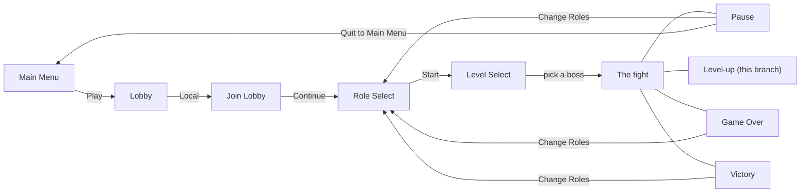

# Player Guide

What a player sees and can do on every screen of the game, as it is built
today. It is written from the player's side: buttons, keys, what is on screen
and what it means. For how each part is built, follow the links to
[`../systems/`](../systems/).

> **Branch note.** This guide describes `feature/roguelike-attacker-progression`.
> Where that branch differs from `main` (automatic firing, the Attacker's
> level-ups, no Attacker combo or Big Shot), the text says **(this branch)**.

## The game in one paragraph

A co-op bullet-hell raid. 1–4 players each fly one ship in a portrait
playfield, pick one of four roles (Attacker, Tank, Medic, Support), and fight
through waves of enemies into a scripted, two-phase boss. Any role nobody
picks is flown by a CPU teammate, so one player can always play a full party.
Ships fire on their own; the player's job is positioning, dodging and using
their role's ability at the right time.

## Screen map

Every menu screen has a **Back** (Esc / gamepad B) that returns one step:
Lobby → Main Menu, Join Lobby → Lobby, Role Select → Join Lobby,
Level Select → Role Select. **Restart** on Pause, Game Over or Victory replays
the same boss with the same party.

## Controls at a glance

**Menus** (every screen before the fight, and the Pause / Game Over / Victory
overlays)

| Action | Keyboard & mouse | Gamepad |
| --- | --- | --- |
| Move focus | Arrow keys, or hover with the mouse | D-pad / left stick |
| Select | Enter, or click | A |
| Back | Esc | B |

Some screens have their own keys (joining, the co-op role picker); see
[menus.md](menus.md).

**In the fight**

| Action | Keyboard & mouse | Gamepad |
| --- | --- | --- |
| Move | Arrow keys | Left stick |
| Fire | Automatic, no key **(this branch)** | Automatic |
| Role ability | E | X (West) |
| Trigger a CPU teammate's ability | Click its ability cell on the left rail | — |
| Pause / resume | Esc | Start |
| Pick a level-up card **(this branch)** | 1 / 2 / 3, or click | D-pad + A |

Each player uses only the device they joined with. Pause is shared: anyone's
Esc or Start pauses everyone. How the controls are wired:
[../systems/input.md](../systems/input.md).

## Settings

**There is no Settings or Options screen yet**, and none is on the roadmap.
Today that means:

- **Controls are fixed.** Nothing can be rebound. (Movement is arrow keys on
  the keyboard, not WASD.)
- **No audio**, so no volume options.
- **No graphics or display options.** The game runs in the Unity Editor's Game
  view; there is no build yet.
- **Party and difficulty** are chosen through the screens themselves: how many
  players join in Join Lobby, roles in Role Select, the boss in Level Select.
  There is no difficulty setting.

## Pages

| Page | What it covers |
| --- | --- |
| [menus.md](menus.md) | Main Menu, Lobby, Join Lobby, Role Select (solo and co-op), Level Select |
| [the-fight.md](the-fight.md) | How a level runs, reading the HUD, damage and survival, enemies, CPU teammates, level-ups |
| [roles.md](roles.md) | The four roles: stats, passives, abilities, how to play each |
| [bosses.md](bosses.md) | Marauder, Halcyon and Warden: what they do and how to beat them |
| [overlays.md](overlays.md) | Pause, Level-up, Game Over and Victory |

## Keeping this guide current

Update the matching page whenever a screen, a control or a rule a player can
see changes. Implementation details belong in [`../systems/`](../systems/),
not here. The project's build status is in [../current-state.md](../current-state.md).
